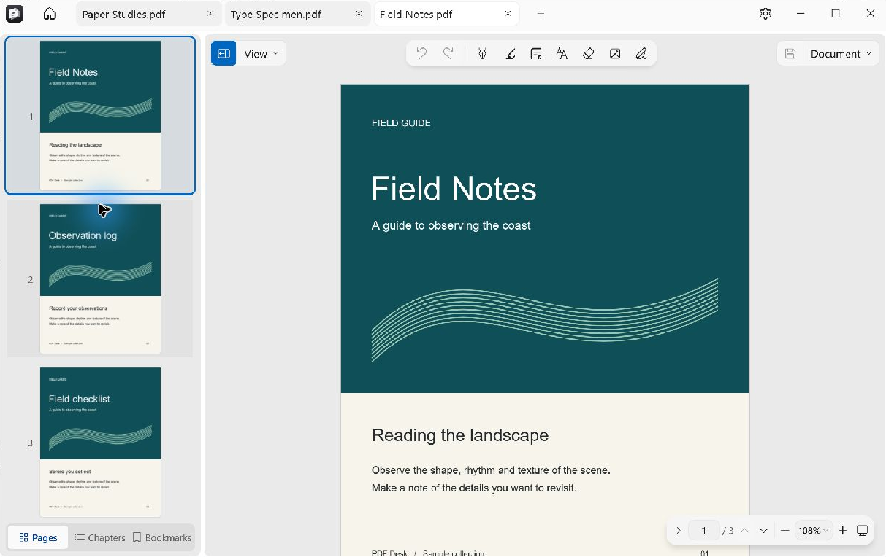
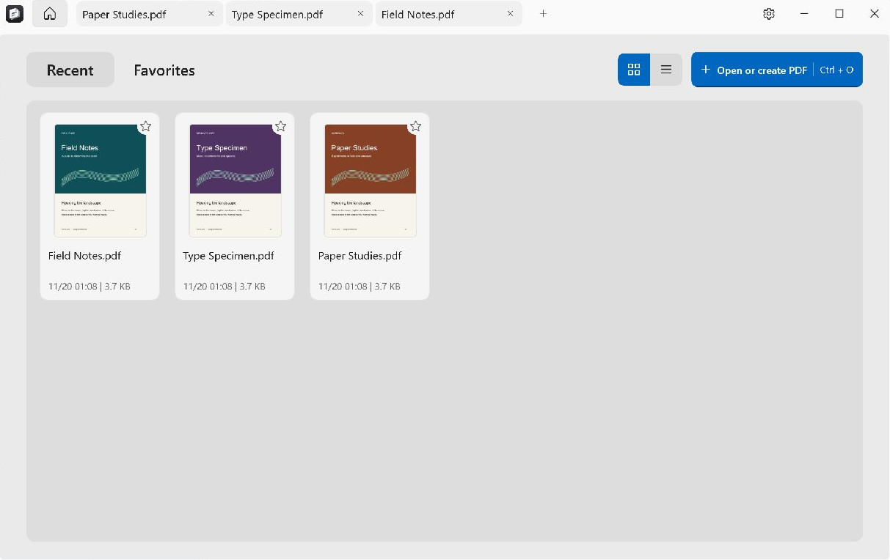
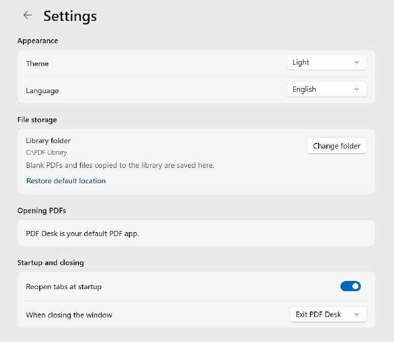

<div align="center">
  
  <h1>PDF Desk</h1>
  <p>A local PDF reader and editor for Windows.</p>
  <p><strong>English</strong> · <a href="README.zh-CN.md" lang="zh-CN">简体中文</a></p>
</div>

Keep frequently used PDFs on a bookshelf and open them in tabs to read, annotate, fill out forms, or assemble a new document from selected pages. PDF Desk processes documents on your computer and works without an account. The interface is available in English and Simplified Chinese.



## Getting started

1. Check [GitHub Releases](https://github.com/DavidLabWorks/pdf-desk-windows/releases) for a Windows package matching your device (ARM64 or x64). For the portable edition, keep the folder together and run `PDFDesk.exe`.
2. Open a PDF from the bookshelf. Choose **Open original** to edit the file in place, or **Copy to library** to keep the original and edit a separate copy.
3. Use the toolbar above the page to draw, highlight text, add a note, or insert a text box. Press `Ctrl+S` to save or `Ctrl+Shift+S` to save a copy. The Home button in the upper left returns you to the bookshelf.

## Bookshelf and reading



- **Bookshelf.** Recent files and favorites each remember your choice of grid or list view. Use the star to save a PDF directly or choose a favorites folder. Drag a document from the shelf or drop PDFs from File Explorer onto a folder in the left pane. Select a folder to browse, rename, or delete it. Deleting a folder keeps its PDFs in Unfiled. Cards show the file name, date added, and size. Right-click a file to open its location or remove it from the list.
- **Reading.** Open several documents in tabs and arrange pages in one, two, or three columns. Fit a page to the window or its width, rotate it, switch to night mode, or enter full-screen presentation mode. Session restore remembers your open tabs and whether you left the app on Home.
- **Navigation.** Jump to a thumbnail, outline entry, personal bookmark, link, or page number. Document search lets you step through matches in either direction. Text selection and highlighting use the PDF’s text layer.

## Annotations, forms, and page editing

| Tool | What you can do |
| --- | --- |
| Pen and highlighter | Draw across page boundaries, erase part of a stroke, or highlight selected text. Adjust pen color, width, and opacity. |
| Sticky notes and text boxes | Click a note marker to read or delete it. Insert text, then reopen the box to edit, move, or resize it. Choose the size, color, and alignment. Chinese font choices include Microsoft YaHei, SimSun, and DengXian when installed. |
| Images and handwritten signatures | Insert a picture, draw a signature, type your name, or import a signature image. Reuse saved signatures and move or resize them on the page. |
| Forms and digital signatures | Fill in standard AcroForm fields. PDF Desk flags XFA forms that it cannot fill. Document information shows details of existing digital signatures. Certificate and signature validation are currently unsupported. |
| Page editing | Select multiple thumbnails to reorder, delete, extract, or insert pages. Copy and paste pages between tabs, and undo or redo common edits. |
| Saving and printing | Save in place, save a copy, flatten annotations into the page, or print through Windows. Print at actual size or shrink oversized pages to the printable area. Save flattened output as a separate file if you want to keep editing the annotations in the original. |

## What gets saved with the PDF?

| Location | Contents |
| --- | --- |
| The PDF file | Saved ink, highlights, sticky notes, images, handwritten signatures, inserted text, form values, and page edits travel with the file. |
| `PDFDesk\PDFDesk.json` in your Windows Documents folder | Recent files, favorites, personal bookmarks, reading positions, layouts, open tabs, and preferences such as theme and language. |
| `PDFDesk\Library` in your Windows Documents folder | The default location for library copies and new documents. You can choose another folder in Settings. |
| `%LOCALAPPDATA%\PDFDesk` | Cached cover thumbnails, reusable signature images, page clipboard data, and the local error log (`errors.log`). |

A handwritten signature is a visible annotation that recipients can see when they open the saved PDF. A digital signature serves a different purpose: it can be used to verify the signer’s identity. See the [privacy policy](PRIVACY.md) for details about local data.



## How it works

PDF Desk uses **C#, .NET 10, WinUI 3, Win2D, and PDFium**. The UI handles mouse, touch, pen, and keyboard input. The engine manages documents and page layout. The native interop layer owns the PDFium bindings and manages native handles.

| Feature | Implementation and source |
| --- | --- |
| Large documents | File access callbacks read PDF data on demand. The viewer requests tiles for the visible area and draws them on a Win2D virtual canvas. A scheduler prioritizes rendering and background work, while a cache keeps page handles available for reuse. [File access](src/PDFDesk.PdfiumInterop/FileAccessAdapter.cs) · [Scheduler](src/PDFDesk.Engine/RenderScheduler.cs) · [Page cache](src/PDFDesk.Engine/PdfDocument.PageCache.cs) |
| Layout, zoom, and search | The layout engine calculates each page’s bounds. Rotation transforms map document coordinates to the screen, zoom uses an anchor to preserve the reading position, and search uses extracted text and character positions. [Layout](src/PDFDesk.Engine/PageLayout.cs) · [Zoom anchor](src/PDFDesk.Engine/ZoomAnchor.cs) · [Search](src/PDFDesk.Engine/DocumentSearch.cs) |
| Ink, highlights, and notes | The engine writes standard PDF ink, text markup, and text annotations. It splits cross-page strokes at page boundaries, clips ink along the eraser’s path, and stores sticky-note text in the annotation’s `/Contents` entry. [Annotations](src/PDFDesk.Engine/PdfDocument.Annotations.cs) · [Cross-page ink](src/PDFDesk.Engine/PageInkGesture.cs) · [Eraser](src/PDFDesk.Engine/InkEraser.cs) |
| Editable text and Chinese fonts | Text objects go into a stamp annotation’s appearance stream. PDF Desk retains the original text and layout information for later edits. For supported Chinese fonts, it checks embedding permissions and embeds a TrueType subset containing the glyphs used. [Text boxes](src/PDFDesk.Engine/PdfDocument.Text.cs) · [Font subsetting](src/PDFDesk.Engine/PdfTextFallback.cs) |
| Images, signatures, and forms | Images and handwritten signatures use stamp annotations. PDF Desk can remove the paper background from an imported signature locally. The PDFium form environment handles form input, and a separate reader inspects existing digital signatures. [Image stamps](src/PDFDesk.Engine/PdfDocument.Stamps.cs) · [Background removal](src/PDFDesk.Engine/SignatureMatte.cs) · [Forms](src/PDFDesk.Engine/PdfDocument.Forms.cs) · [Digital signatures](src/PDFDesk.Engine/PdfDocument.Signatures.cs) |
| Page operations and printing | PDFium imports, exports, and reorders pages. The print service renders pages for the selected paper and printable area, then passes them to the Windows print pipeline for preview and printing. [Page operations](src/PDFDesk.Engine/PdfDocument.Pages.cs) · [Flattening](src/PDFDesk.Engine/PdfDocument.Flatten.cs) · [Print service](src/PDFDesk.App/Services/PrintService.cs) |
| Library and desktop integration | Library imports use a temporary copy and handle duplicate file names. Settings writes use a mutex and replace the destination with a temporary file. Single-instance activation routes subsequent file-open requests to the existing window. [Library](src/PDFDesk.Engine/PdfLibrary.cs) · [Settings and sessions](src/PDFDesk.Engine/AppState.cs) · [Window activation](src/PDFDesk.App/Services/SingleInstance.cs) |

## Build from source

Install the .NET 10 SDK on Windows and run the following commands in PowerShell from the repository root. NuGet restores WinUI, Win2D, PDFium, and the other dependencies. This example produces a self-contained ARM64 portable folder with the required .NET and Windows App SDK components.

```powershell
dotnet publish src/PDFDesk.App/PDFDesk.App.csproj -c Release -r win-arm64 --self-contained -p:Platform=ARM64 -p:WindowsPackageType=None -o artifacts/portable/win-arm64
.\artifacts\portable\win-arm64\PDFDesk.exe
```

For x64, use `-r win-x64`, set `-p:Platform=x64`, and choose a separate output folder. To work with the solution in an IDE, open [PDFDesk.slnx](PDFDesk.slnx).

### Tests

```powershell
dotnet test tests/PDFDesk.Tests/PDFDesk.Tests.csproj -c Release
```

Tests cover page layout, render scheduling, text search, annotation and form round trips, reopening embedded fonts, page operations, and state persistence. Sample documents are in [tests/corpus](tests/corpus). The [desktop test cases and results (Simplified Chinese)](docs/测试用例与结果.md) describe UI scenarios, ARM64 memory measurements, and what was verified.

## Keyboard shortcuts

| Action | Shortcut |
| --- | --- |
| Open / save / save as | `Ctrl+O` / `Ctrl+S` / `Ctrl+Shift+S` |
| Find text / go to page | `Ctrl+F` / `Ctrl+G` |
| Fit width / fit page | `Ctrl+2` / `Ctrl+0` |
| Pen / highlighter / insert text | `Ctrl+E` / `Ctrl+H` / `Ctrl+T` |
| Toggle sidebar / present | `F9` / `F5` |
| Print / document information | `Ctrl+P` / `Ctrl+D` |
| Find a command / show all shortcuts | `Ctrl+K` / `F1` |

## Credits and license

PDF Desk builds on [Rune](https://github.com/DanialJaved/rune) by Danial Javed and contributors. It is licensed under the [GNU GPL v3](LICENSE). Licenses for bundled components are listed in the [third-party notices](THIRD-PARTY-NOTICES.md).

To report a problem, open a [GitHub issue](https://github.com/DavidLabWorks/pdf-desk-windows/issues) with steps to reproduce it, the app version, your Windows version, and system architecture. Redact private file names and paths from screenshots and logs before attaching them.
