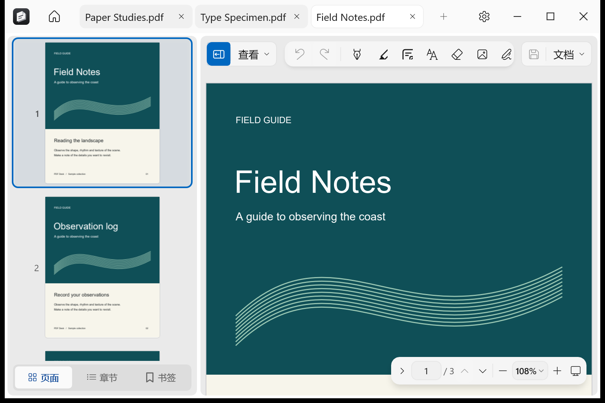
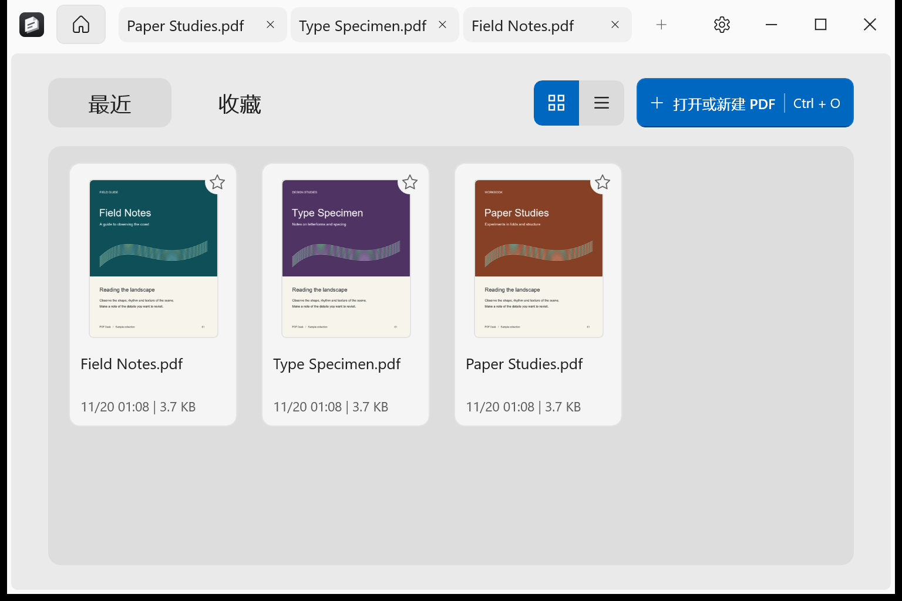
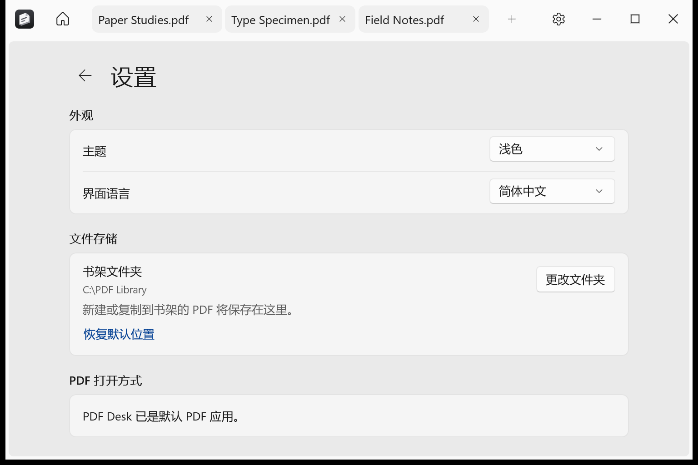

<div align="center">
  
  <h1>PDF Desk</h1>
  <p>面向 Windows 和 macOS 的本地 PDF 桌面应用。</p>
  <p><a href="README.md" lang="en">English</a> · <strong>简体中文</strong></p>
</div>

| 平台 | 工程入口 | 当前功能 |
| --- | --- | --- |
| Windows | [Visual Studio 解决方案](windows/PDFDesk.slnx) | 书架、阅读、批注、表单、页面整理、压缩与打印。 |
| macOS | [Xcode 工程](macos/PDFDesk.xcodeproj) | SwiftUI + PDFKit 只读阅读器。在 macOS 13 或更高版本用 Xcode 打开工程并运行 PDFDesk，选择「文件 → 打开」即可阅读 PDF。 |

两端共用[产品需求](docs/macOS版产品需求与实现规格.md)、[测试 PDF](tests/corpus/) 和[设计技能](skills/pdfdesk-design/SKILL.md)。以下是已发布 Windows 版的使用与构建说明。

PDF Desk 把书架和阅读器放在同一个窗口。你可以把常看的文档加入收藏，在多个 PDF 之间切换，填写表单、添加签名，或把不同文件中的几页整理成一份新文档。文档处理在本机完成，无需注册账号。界面支持简体中文和英文。



## 开始使用

1. 在 [GitHub Releases](https://github.com/DavidLabWorks/pdf-desk-windows/releases) 查看可用的 Windows 发布包。按设备架构选择 ARM64 或 x64。使用便携版时保留整个文件夹，运行其中的 `PDFDesk.exe`。
2. 在书架点击「打开或新建 PDF」，选择打开原文件或复制到书库。直接打开适合编辑已有文件；复制模式适合保留原稿，后续编辑写入书库里的副本。
3. 打开文档后，从顶部工具栏选择画笔、荧光笔、便签或文字工具。`Ctrl+S` 保存到当前文件，`Ctrl+Shift+S` 另存一份。左上角的主页按钮可随时返回书架。

## 书架与阅读



- **书架**支持最近、收藏、封面卡片和列表视图。点击星标可以直接收藏，也可以指定收藏文件夹。可将书架文档或资源管理器中的 PDF 拖入左侧文件夹。选中文件夹即可浏览、重命名或删除。删除文件夹后，其中的 PDF 会保留在未分类收藏中。卡片显示文件名、添加日期和大小，可通过右键菜单定位文件或从列表移除。最近与收藏分别记住视图选择。
- **多标签阅读**支持单列、双列和三列排版、适合宽度、适合页面、旋转、夜间阅读及全屏演示。启用会话恢复后，重启可回到之前的文档标签或主页。
- **页内导航**可通过缩略图、文档目录、个人书签、链接或页码跳转。全文查找支持上一个和下一个匹配项。文字选择和荧光笔依赖 PDF 中可提取的文字层。

## 批注、表单与页面整理

| 功能 | 可以怎样使用 |
| --- | --- |
| 画笔与荧光笔 | 自由书写、跨页画线、用橡皮擦局部擦除笔迹，或选中文字后高亮。画笔可调颜色、粗细和透明度。 |
| 便签与文字框 | 点选页面添加便签，点击标记可查看或删除。在页面输入文字后可再次编辑、移动和调整文本框；支持字号、字色、对齐，以及本机已安装的微软雅黑、宋体和等线。 |
| 图片与手写签名 | 在页面放置图片，或通过手写、输入姓名、导入图片创建签名。保存的签名可以复用，放置后可拖动和缩放。 |
| 表单与数字签名 | 直接填写标准 AcroForm 表单。遇到 XFA 表单会提示兼容性限制。已有数字签名可在「文档信息」中查看详情，PDF Desk 当前未提供证书和签名有效性验证。 |
| 页面整理 | 在缩略图侧栏多选、拖动排序、删除、提取或插入页面。复制和粘贴页面可跨标签使用，常用编辑操作支持撤销、重做。 |
| 输出 | 可保存、另存、将批注合并到页面或调用 Windows 打印。打印支持实际大小，以及仅在页面超出可打印区域时缩小。需要保留批注编辑能力时，建议把合并后的结果另存一份。 |

## 哪些内容会随文件带走？

| 保存位置 | 内容 |
| --- | --- |
| 当前 PDF | 保存后的画笔、文字高亮、便签、图片、手写签名、添加的文字、表单值和页面调整。分享 PDF 即可带走这些改动。 |
| Windows「文档」目录下的 `PDFDesk\PDFDesk.json` | 最近文件、收藏、个人书签、文档阅读位置与布局、打开的标签，以及主题和语言等偏好。 |
| Windows「文档」目录下的 `PDFDesk\Library` | 默认书库，用于存放复制进来的 PDF 和新建文档。可以在设置中选择其他书库目录。 |
| `%LOCALAPPDATA%\PDFDesk` | 封面缩略图、供复用的签名图片、页面剪贴板数据，以及本机错误日志 `errors.log`。 |

手写签名是页面上的可见批注。将它放入 PDF 并保存后，接收方即可看到签名图像；验证签署者身份则属于数字签名的用途。更多数据处理说明见[隐私政策](PRIVACY.md)。



## 技术实现

应用使用 **C#、.NET 10、WinUI 3、Win2D 和 PDFium**。界面负责接收鼠标、触控、笔和键盘输入；引擎负责文档操作与布局；原生互操作层集中管理 PDFium 接口和句柄。

| 功能 | 实现方式与代码入口 |
| --- | --- |
| 大文档阅读 | 通过文件访问回调按需读取 PDF。阅读器按视口请求图块，在 Win2D 虚拟画布上绘制；调度器按优先级处理渲染和后台任务，页面句柄由缓存复用。[文件读取](windows/src/PDFDesk.PdfiumInterop/FileAccessAdapter.cs) · [渲染调度](windows/src/PDFDesk.Engine/RenderScheduler.cs) · [页缓存](windows/src/PDFDesk.Engine/PdfDocument.PageCache.cs) |
| 排版、缩放与搜索 | 页面布局计算每页的显示矩形，旋转变换负责文档坐标与显示坐标之间的转换。缩放使用锚点维持阅读位置，搜索基于提取的页面文本及字符位置。[页面布局](windows/src/PDFDesk.Engine/PageLayout.cs) · [缩放锚点](windows/src/PDFDesk.Engine/ZoomAnchor.cs) · [搜索](windows/src/PDFDesk.Engine/DocumentSearch.cs) |
| 笔迹、高亮与便签 | 写入 PDF 标准墨迹、文本标记和文本批注。跨页笔迹按页拆分，橡皮擦根据擦除轨迹裁切笔画；便签把正文写入批注的 `/Contents`。[批注读写](windows/src/PDFDesk.Engine/PdfDocument.Annotations.cs) · [跨页笔迹](windows/src/PDFDesk.Engine/PageInkGesture.cs) · [局部擦除](windows/src/PDFDesk.Engine/InkEraser.cs) |
| 可编辑文字与中文字体 | 将文本对象写入印章批注的外观流，保留原文和排版信息供再次编辑。指定中文字体时检查嵌入权限，按所用字形生成 TrueType 子集，减少对接收方字体环境的依赖。[文字框](windows/src/PDFDesk.Engine/PdfDocument.Text.cs) · [字体子集](windows/src/PDFDesk.Engine/PdfTextFallback.cs) |
| 图片、签名与表单 | 图片和手写签名使用印章批注，签名图片可在本地去除背景。表单输入交给 PDFium 的表单环境处理，文档已有数字签名的信息单独读取。[图片印章](windows/src/PDFDesk.Engine/PdfDocument.Stamps.cs) · [签名去底](windows/src/PDFDesk.Engine/SignatureMatte.cs) · [表单](windows/src/PDFDesk.Engine/PdfDocument.Forms.cs) · [数字签名](windows/src/PDFDesk.Engine/PdfDocument.Signatures.cs) |
| 页面操作与打印 | 引擎通过 PDFium 导入、导出和重排页面。打印服务将 PDF 页按纸张和可打印区域渲染，交给 Windows 打印管线生成预览和作业。[页面编辑](windows/src/PDFDesk.Engine/PdfDocument.Pages.cs) · [展平批注](windows/src/PDFDesk.Engine/PdfDocument.Flatten.cs) · [打印服务](windows/src/PDFDesk.App/Services/PrintService.cs) |
| 书库与桌面集成 | 书库导入时先写临时副本并处理重名；配置写入使用互斥锁、临时文件和替换操作。单实例激活负责把后续打开文件的请求转交给已有窗口。[书库](windows/src/PDFDesk.Engine/PdfLibrary.cs) · [配置与会话](windows/src/PDFDesk.Engine/AppState.cs) · [窗口激活](windows/src/PDFDesk.App/Services/SingleInstance.cs) |

## 从源码构建

在 Windows 安装 .NET 10 SDK 后，从仓库根目录运行 PowerShell。项目通过 NuGet 还原 WinUI、Win2D 和 PDFium 等依赖。下面以 ARM64 自包含便携版为例，输出文件夹中包含运行所需的 .NET 和 Windows App SDK 组件。

```powershell
dotnet publish windows/src/PDFDesk.App/PDFDesk.App.csproj -c Release -r win-arm64 --self-contained -p:Platform=ARM64 -p:WindowsPackageType=None -o artifacts/portable/win-arm64
.\artifacts\portable\win-arm64\PDFDesk.exe
```

构建 x64 版时，将 RID 改为 `win-x64`、平台改为 `-p:Platform=x64`，并使用独立的输出目录。开发时可打开 [windows/PDFDesk.slnx](windows/PDFDesk.slnx)。

### 测试

```powershell
dotnet test windows/tests/PDFDesk.Tests/PDFDesk.Tests.csproj -c Release
```

测试覆盖阅读布局、渲染调度、文字搜索、批注与表单读写、字体保存后重开、页面操作和状态持久化。测试样本位于 [tests/corpus](tests/corpus)。桌面交互用例、ARM64 内存压力测试的测量方法和已验证范围记录在[测试用例与结果](docs/测试用例与结果.md)。

## 常用快捷键

| 操作 | 快捷键 |
| --- | --- |
| 打开 / 保存 / 另存为 | `Ctrl+O` / `Ctrl+S` / `Ctrl+Shift+S` |
| 查找文字 / 跳转页码 | `Ctrl+F` / `Ctrl+G` |
| 适合宽度 / 适合页面 | `Ctrl+2` / `Ctrl+0` |
| 画笔 / 荧光笔 / 输入文字 | `Ctrl+E` / `Ctrl+H` / `Ctrl+T` |
| 显示侧栏 / 演示模式 | `F9` / `F5` |
| 打印 / 查看文档信息 | `Ctrl+P` / `Ctrl+D` |
| 查找命令 / 查看完整快捷键表 | `Ctrl+K` / `F1` |

## 来源与许可

PDF Desk 基于 Danial Javed 和贡献者开发的 [Rune](https://github.com/DanialJaved/rune) 继续开发，采用 [GNU GPL v3](LICENSE)。随程序分发的组件及其许可见[第三方声明](THIRD-PARTY-NOTICES.md)。

如需反馈问题，可在 [GitHub Issues](https://github.com/DavidLabWorks/pdf-desk-windows/issues) 提交复现步骤，并附上应用版本、Windows 版本及系统架构。截图与日志如涉及私人文档，请先遮盖文件名和路径。
